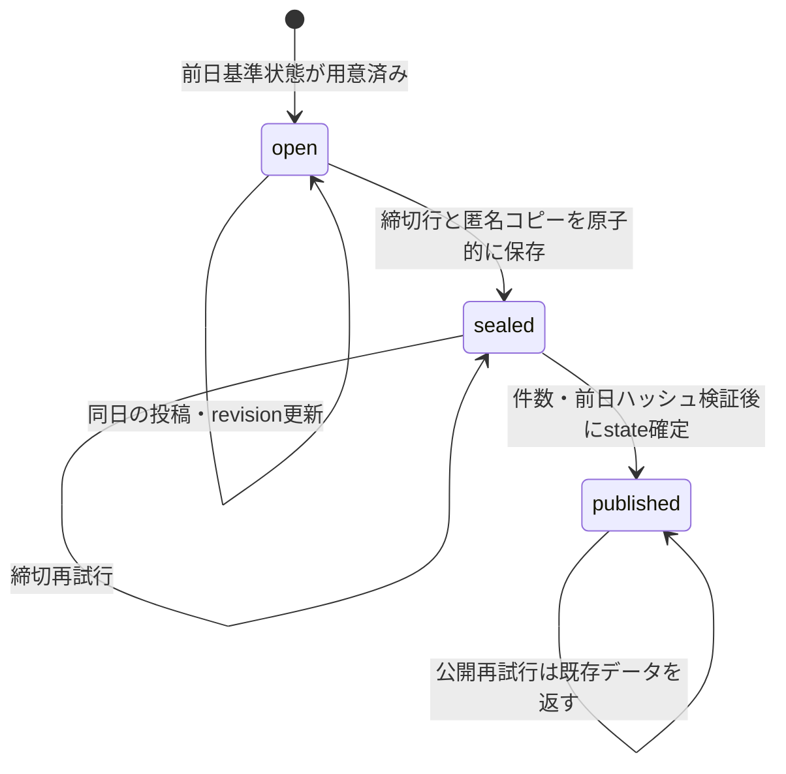
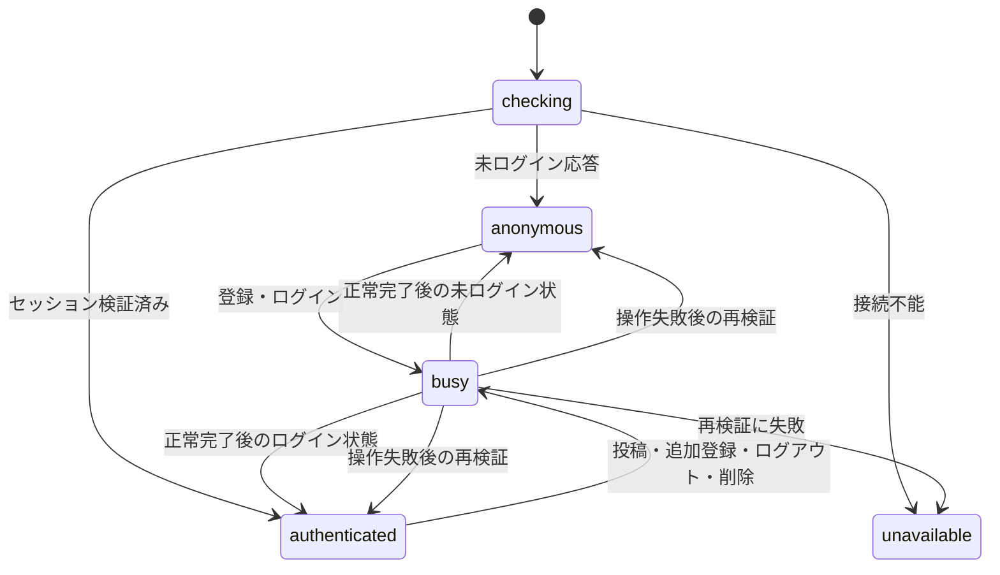

# EROSION MAP — 状態機械・アーキテクチャ仕様（公開開発用）

この文書は一般公開可能な**技術仕様**です。運用手順の秘密、実利用者情報、Work向けの引継ぎ情報は含みません。

> **公開状態：ChatGPT Sitesは未公開。** GitHubのコード公開、日次スナップショットのDB確定、Sitesの一般公開は異なるイベントです。日次処理の `publishDay` はSites公開操作ではありません。

## 1. 境界と責務

| 層 | モジュール | 所有する責務 | 所有しない責務 |
|---|---|---|---|
| 計算ドメイン | `src/engine.ts`, `src/daily.ts` | 受動的・同期的な侵食計算、投稿の最終revisionの統合 | 認証、DB、画面操作 |
| 日次状態機械 | `sites/day-state.mjs` | 日次状態の分類と合法遷移の判定 | DBへの書き込み |
| 認証目的の判定 | `sites/auth-state.mjs` | 登録、ログイン、退会再認証のチャレンジ用途の識別 | 署名検証、セッション発行 |
| 永続層 | `sites/d1-store.mjs` | D1の原子的な投稿・締切・履歴・削除、照合、チャンク読取 | HTTP Origin検証、UI制御 |
| HTTP層 | `sites/worker.mjs` | WebAuthn署名・Origin・Cookie・回数制限・API・Sites Assets | 独自のゲーム計算の定義 |
| UI状態機械 | `public/ui-state.js` | 未接続／認証済み／処理中、履歴の検証状態と表示の選択 | 保存済みデータの真偽の決定 |
| 履歴検証境界 | `public/archive.js` | API・静的アーカイブの取得、SHA-256検証、誤フォールバックの防止 | デモを実データと称すること |
| プレゼンテーション | `public/app.js`, `account.js`, `ranking.js` | DOM、Canvas、操作フィードバック、操作中の禁止 | サーバー認証・DB整合性の最終判断 |

**基準：** D1が権威ある状態を保持する。UIの状態は表示と競合操作の抑止に限り、クライアントの `authenticated` や `busy` をアクセス権限として信頼しない。

## 2. 日次データの状態機械

各日付の状態は永続表から導出する。独立したメモリ内フラグは使わない。

| 永続状態 | 定義 | 許可される操作 | 禁止される操作 |
|---|---|---|---|
| `open` | 対象日の締切行・スナップショットがともに存在しない | 認証済み投稿・同日revision更新、締切 | 公開確定の直接実行 |
| `sealed` | `day_closures`が存在し、対象日の`snapshots`がまだない | 匿名凍結投稿の件数・前日ハッシュ照合、公開確定、締切の再確認 | 投稿の追加・更新 |
| `published` | 対象日の`snapshots`が存在する | SHA-256照合済みの読取、冪等な公開再実行 | 投稿・再締切・既存スナップショットの変更 |

`sites/day-state.mjs` の `classifyDay` は永続行の存在で状態を求め、`transitionDay` はイベントを許可・拒否する。特に **`published` から `open` へ戻る経路は存在しない**。

**異常は別の「保留」状態として扱う。** 匿名コピー件数、前日SHA、チャンク順序、state全体SHAのどれかが不一致なら確定を中止し、元投稿と凍結行を残す。異常時に勝手に空のマップを公開したり、制約を外して再計算しない。

DB初期化前の`uninitialized`は**サイト全体のブートストラップ状態**であり、各日付の`open`とは区別する。最初の投稿の前に基準状態を作り、復旧時には締切済みの日付も含めて、処理対象の日を飛ばさない。

## 3. パスキーチャレンジの状態機械

D1の`challenges`には`kind`、`user_id`、期限とハッシュ化トークンを保存する。現在のスキーマでは`kind='authenticate'`をログインと退会確認の両方に使うため、**`user_id`との組合せが実際の用途**を決める。

| 判定後の用途 | D1 kind | user_id | 完了時の権限 |
|---|---|---|---|
| `register` | `register` | 新規／既存アカウントID | 正常なパスキー登録後にセッションを発行 |
| `login` | `authenticate` | `NULL` | 有効な署名で既存アカウントへログイン |
| `delete` | `authenticate` | 現在のアカウントID | 対応するセッションと署名・再確認の一致後だけ削除 |

`sites/auth-state.mjs`が用途を分類し、別用途のチャレンジを流用した場合は拒否する。チャレンジは単回消費、期限切れ拒否、Origin/RP ID・署名・ユーザー検証は引き続きHTTP層で行う。**フロントエンドのUI状態は、この検証の代わりにはならない。**

## 4. アカウント画面の状態機械

| 状態 | 説明 | 可能な操作 |
|---|---|---|
| `checking` | 初回のサーバー状態を検証中 | なし |
| `unavailable` | バックエンドに接続できない | 再読込のみ |
| `anonymous` | 接続できたが認証されていない | 登録、ログイン |
| `authenticated` | 現在のセッションをAPIで確認済み | 追加パスキー、投稿、ログアウト、アカウント削除 |
| `busy` | いずれか1操作とその後のセッション再検証が進行中 | 同時操作を禁止 |

認証・投稿・削除ボタンは`busy`中にすべて無効化する。これは同じブラウザでチャレンジCookieが上書きされる問題や、重複投稿の意図しない発生を抑えるためである。

## 5. マップ・履歴表示の状態機械

**取得の状態**と**何を画面に表示しているか**は独立した軸である。

| 取得状態 | 意味 | 表示と操作 |
|---|---|---|
| `loading` | APIでの履歴・SHA検証中 | 「保存されないデモ」と明記 |
| `ready` | すべての必要な履歴SHAが一致 | 検証済み履歴／デモを明示的に切替可能 |
| `empty` | 実データや静的履歴がない | デモ、必要なら再試行 |
| `error` | 検証不一致・通信失敗など | **未検証の履歴は表示しない**。エラー表示、再試行 |

**権威あるAPIの取得に成功した後、SHAが一致しなければ静的ファイルにフォールバックしない。** APIエンドポイント自体が存在しない（404／501）の場合だけ、静的アーカイブを独立して検証して表示できる。

ユーザーが読込中にデモを操作した場合、遅れて取得できた履歴は検証済みとして保持するが、**ユーザーの表示選択を勝手に変更しない**。

ランキング画面も同じ検証境界を共有する。履歴の整合性に失敗した場合、実データの代わりに合成ランキングを表示しない。履歴が存在しないことが明確な場合だけ、デモであることを表示して計算する。

ランキングは`visitPublishedArchive`で履歴を日付順に検証し、`createRankingAccumulator`が出現日数と最新日の勢力値だけを保持する。これにより30日分の全セル配列をブラウザに保持しない。各日のJSONを取得・検証する転送量は残り、完全なゼロメモリ運用を保証するものではない。

## 6. UIの設計原則

- データ来歴：`DEMO`／`VERIFIED STATIC`／`VERIFIED DATABASE`を区別する。
- 操作結果：成功・進行中・取消・通信失敗・整合性失敗を同じ「完了」表示にまとめない。
- アクセシビリティ：ライブステータス、キーボードスキップリンク、明確なフォーカス、タッチ対象、狭い画面でのナビゲーション折返しを提供する。
- 連携：APIの認証と整合性が常に権威を持ち、ボタンの無効化だけでアクセス制御を実現したとみなさない。
- 暫定ゲーム仕様：受け取り側同期更新、同文字集約、N=1伝播候補は本変更の対象外。Issue #1〜#3が未承認のまま運用仕様を確定させない。

## 7. 検証境界

Node.js 22・24の単体テストとSQLiteによるD1 API模擬試験は**コードの検証**である。実際のChatGPT Sitesは未公開であり、ネイティブD1、実機WebAuthn、ブラウザ上でのアクセシビリティ実測、本番バックアップ・復元、本番メモリ制限は検証済みと扱わない。
